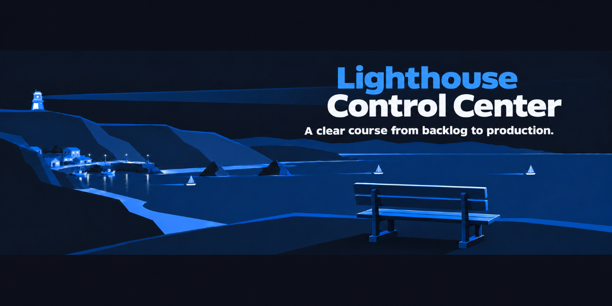

# Lighthouse Control Center



SoFa is evolving into Lighthouse Control Center.

SoFa observes engineering activity and delivery evidence across configured repositories. GitHub workflows own orchestration and an independent runtime executes agents. SoFa projects source evidence and highlights decisions or missing information; stopping it does not stop repository delivery.

## Open the authenticated workspace

The supported entrypoint is the .NET workspace composed by Aspire with an isolated development Keycloak provider. Follow the [development identity runbook](docs/runbooks/development-identity.md) to create private HTTPS configuration, register the separate GitHub App and sign in. Then run:

```sh
SOFA_CONFIG_FILE="$HOME/.config/sofa-dev/development.json" npm start
```

Open the exact HTTPS address configured in that private file. Owner admission uses the configured issuer/subject and verified password in development; the external identity profile retains MFA. Connect a GitHub account separately; repository observations use that user's effective app/repository authority. Credentials remain server-side. A restart ends local sessions and source connections.

The account view shows the acting account, source-check times and configured repository permissions. The operations view retains the first bounded observation slice: active workflow groups, source revisions, human-wait labels, repository filtering and safe GitHub links. Source-update age is separate from observation time; unavailable evidence stays unknown. Workflow waiting does not identify an approver. Counts cover the latest twenty runs and first hundred open issue records per configured repository, with PR records excluded from attention.

Observation data is coalesced within the owner/session connection scope for fifteen seconds. Permission checks precede cache reuse. Background polling does not renew the session; authority loss clears displayed records and counts. Temporary transport failure retains old source times with a stale warning. Issue commands, full discovery/boards/inbox and runtime/capacity metrics remain work under #50/#51/#52/#57 and their dependencies.

Development Keycloak protocol, revocation and outage behavior have a separate nightly/manual E2E suite, outside PR/push CI. The owner confirmed actual GitHub connection and operational data on a computer. Physical-phone rehearsal was deferred by the owner; narrow browser tests do not establish physical-device acceptance. Production custody, persistence and deployment remain #58 work.

Install browser prerequisites with `npx playwright install --with-deps chromium` before verification. CI retains safe post-callback screenshots and reports. Its identity-provider test requires `libnss3-tools` for an isolated browser trust database.

## Repository map

- [`docs/product/`](docs/product/README.md): ProductShape model and Product Changes.
- [`docs/architecture/`](docs/architecture/README.md): ArcShape-managed arc42 architecture documentation.
- [`docs/engineering-lifecycle.md`](docs/engineering-lifecycle.md): shared Agentic SDLC gates and working agreements.
- [`src/`](src/README.md): authenticated workspace, source observations, repository tooling and retained legacy execution code.
- [`tests/`](tests/README.md): runtime, PostgreSQL, container, bridge and repository tests.

## Tooling

Verification requires Node.js 22 or newer, .NET 10 and Docker. Install dependencies and run the checks with:

```sh
npm ci
npm run verify
# Separate E2E suite: real provider, trusted browser and accessibility:
npm run verify:identity:host
```

`npm run verify:dotnet` runs locked restore, Release build, the relevant source-format/module checks, real LH1001/LH1002 rejection and solution tests through the existing PostgreSQL/Docker lanes. The separate identity E2E suite composes disposable resources and does not require production identity or a GitHub user grant.

ProductShape and ArcShape are pinned as local development dependencies. Their managed files are refreshed through their CLIs; see [tooling notes](docs/tooling.md).

Run `npm run observe -- owner/repository [owner/another-repository]` with an authenticated `gh` client to collect current workflow and issue observations. Its attention list includes requests for information, active agent work, ready items and issues waiting for review, preserving their source labels. This command only reads GitHub. This historical CLI uses operator authentication explicitly. The authenticated web adapter uses its connected GitHub user and never falls back to this collector.

Run observations add optional `startedAt` from GitHub `run_started_at`, alongside unchanged `updatedAt`, source facts and the mixed `attention` collection. Absent or invalid source timing is not replaced with an inferred timestamp.

Both the historical CLI snapshot and authenticated web projection include `runAttempt` from GitHub `run_attempt` and `event` from GitHub `event`. Attempts are exact positive integers through 9007199254740991; missing, malformed, fractional or out-of-range values serialize as `null`. Integral decimal/exponent forms remain known, but `1.00000000000000001` is fractional and stays unknown. Events preserve nonblank source strings; other values serialize as `null`, never inferred from workflow names or status. For example, `"runAttempt": 2, "event": "workflow_dispatch"` distinguishes a retry from attempt 1, not proof of successful recovery. Every operations run card labels Source attempt and Triggering event, displaying `unknown` for nulls or older snapshots without these fields. Existing source links and run identity are unchanged.

The former supervisor is retained for historical rollback, disabled by default and no longer started by AppHost. See [ADR-0006](docs/architecture/09-architecture-decisions/0006-observe-repository-owned-workflows.md).

The repository's own development workflows use the pinned Lighthouse gh-aw/OpenCode adapter. See [repository workflow operation](docs/runbooks/repository-workflows.md) for runner setup, stage requests, evidence and recovery.

See the [Lighthouse adoption inventory and dogfooding guide](docs/runbooks/lighthouse-dogfooding.md) for the current package/profile/source-contract baseline, reproducible verification and the still-pending authenticated mission demonstration.
