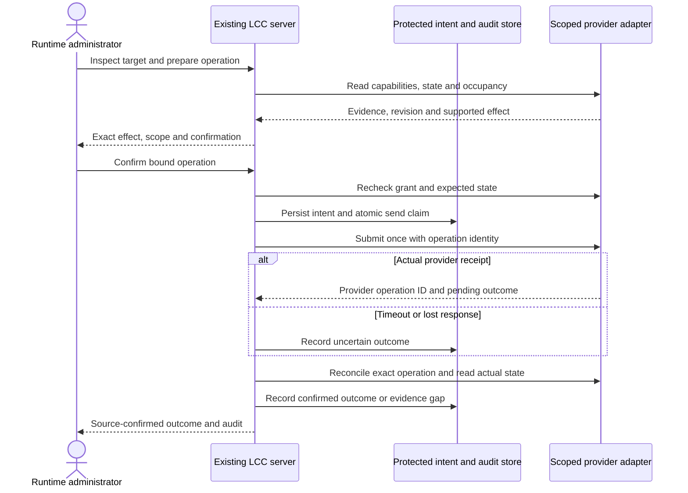

# 06. Repository execution and observation

An authorized GitHub event reaches the repository router and one stage worker. The worker reserves the issue, collects current source and owner answers, invokes the independent executor, validates the result, rechecks authority and publishes through GitHub. Named Actions steps, progress metadata, a summary and artifacts expose the run. SoFa may refresh observations at any time, including after the run; its availability does not affect execution. An owner answer to a pending refinement resumes through the same repository route.

## Authenticated observation

The browser first establishes an owner session through the configured provider. A separate GitHub authorization creates the acting-account connection. Protected queries revalidate identity when due, check current repository authority before any cache lookup and project bounded source observations. Concurrent reads share collection only within that session/connection generation. Disconnect, rejected source authority and account replacement invalidate the applicable cached data.

The browser refreshes observations while visible. Transport failures preserve old source timestamps with a stale warning; owner/source authority loss clears the displayed records and counts. No observation request dispatches or cancels work. The [query adapter](../../../src/SoFa.Modules.Workspace/Source/GitHubObservations.cs) and [HTTP boundary tests](../../../tests/SoFa.Web.Tests/OwnerBoundaryTests.cs) provide implementation evidence.

<!-- pdac:cite id="QR-EXECUTION-SECURITY" digest="sha256:314e97415b3211a4f4e6187bb16495661d31129062e6bda38ceb8a2a4d4e9790" -->

## Session failure and source-account transitions

Due provider revalidation blocks the protected request until it succeeds. Recognized revocation removes local authority; temporary failure preserves the original session deadlines but grants no stale access. CSRF-protected local logout/disconnect remain available during provider outage. A late refresh cannot restore removed authority.

GitHub callback state is single-use and bound to the owner session and connection attempt. A verified different account requires explicit confirmation; failed or cancelled replacement preserves an otherwise valid existing connection. Reference rotation preserves the original deadlines and the latest server-held provider tokens. Shared mechanisms are described in [section 08](../08-crosscutting-concepts/README.md).

<!-- pdac:cite id="FR-RECOVERABLE-EXECUTION" digest="sha256:02460c262c7ad33b35456a43d2f878a3791494aae51aa1b70f2578069054f176" -->

See [ADR-0006](../09-architecture-decisions/0006-observe-repository-owned-workflows.md) for the accepted boundary and superseded design.

## Implemented issue reads

A configured ordinary issue is read only after owner and effective GitHub issue-read authority pass. Explicit conversation pages retain source identity/time, observation time and coverage. A changed issue snapshot interrupts paging; incomplete or failed collections never establish emptiness. Optional evidence reads recheck Actions authority and follow exact report/run/artifact or issue/PR references, preserving workflow status separately from a stage result.

The source artifacts are streamed within ZIP/member bounds, kept in memory and passed as JSON to the installed Lighthouse validator through a tokenless offline process. This validates the shared result format; it does not decide current command eligibility or assert a live host lease. Source account loss destroys the applicable connection and removes displayed context. Temporary failure retains explicitly stale readable data. See [issue evidence tests](../../../tests/SoFa.Web.Tests/IssueEvidenceTests.cs).

<!-- pdac:cite id="BR-GITHUB-SOURCE" digest="sha256:fd8141424d5fead38ed55d54689511fc445467133706e875371cc3199af8ab1a" -->

## Proposed issue operation

1. The browser loads issue context through the authenticated query adapter. The response includes source revision, observation age and the shared capability decision, including denial reasons.
2. The owner sees the acting GitHub identity and the effect, then submits an explicit command with its stable request identity and expected issue/evidence version.
3. The server checks session, CSRF/origin protection, configured repository scope and current GitHub user authority; it obtains fresh evidence and shared eligibility. A changed state returns a refreshed explanation without dispatch.
4. The command adapter durably records intent before sending. The repository rechecks authority, reservations and evidence at admission; preflight success is not a reservation.
5. The source receipt identifies the workflow run. The query adapter follows its jobs, human waits and published stage result. Proposal success links its actual proposal/PR; it does not authorize implementation.
6. A reload or another device resumes the same request history. Closing SoFa leaves admitted execution running.

### Failure behavior

A timeout after sending records an uncertain command. Reconciliation uses the source run receipt or the shared request identifier, never proximity in time. Until admission or rejection is proven, SoFa does not silently resend. Failed or cancelled runs retain their identity and result. A source run with no stage result remains incomplete evidence. Session expiry blocks new actions but does not cancel admitted work.

### Comments and continuation

Ordinary comment and reply-and-continue are different user intents. The repository's shared contract must preserve that distinction, including on needs-info issues. A source-confirmed comment ID is the receipt. A lost posting response is reconciled before another post. When source input digests include owner conversation, show that posting during work may invalidate pending publication. Do not temporarily remove labels to suppress continuation.

### Portfolio and signals

Search, project boards and inbox resolve stable source identities and enter the same issue flow. A signal drill-down uses retained source observations and its calculation/version, not a fresh unrelated aggregate. An idea stays a draft until explicit create-or-link; uncertain issue creation uses the same receipt principles.

## Proposed runtime-administration flow

[ADR-0010](../09-architecture-decisions/0010-administer-independent-runtime-providers.md) governs this proposed flow. Repository action submission continues through the existing #48 source-control flow above.

A denied session, revoked provider grant, changed target or unsupported capability prevents submission. A restart requires provider-enforced quiescence/admission fencing; a poll returning idle is insufficient. LCC restart recovers an operation for reconciliation only. A provider-side capacity operation can finish after LCC stops. Current repository attempts continue independently. A narrow local helper repeats target/state checks at the mutation boundary so a browser or web-process check is never the sole protection.

### Proposed telemetry projection

Read public Lighthouse telemetry per `(stream, sequence)` cursor and deduplicate by event ID. Persist an ingested record and cursor atomically before advancing; after restart replay from the committed cursor. Stream disappearance/retention loss creates an explicit collection gap. Hosted-job artifacts are fetched separately; runner-only journals do not contain every hosted event. Explicit source/correlation IDs join issue, request, workflow attempt, job, runner and engine session; unavailable links remain unavailable. Current state and retained historical facts have different freshness. No event or transport trace grants a delivery verdict.
