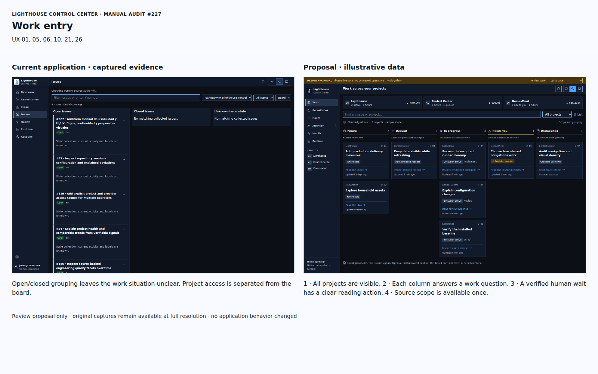
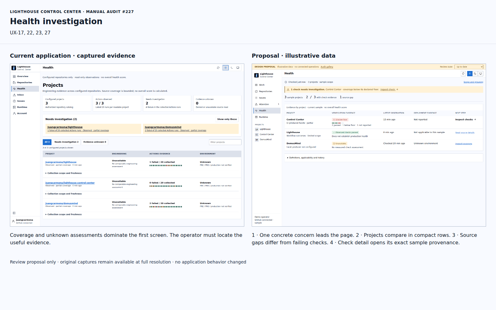
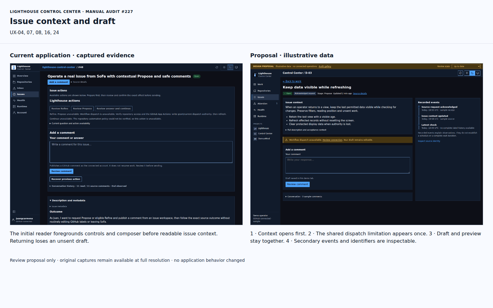
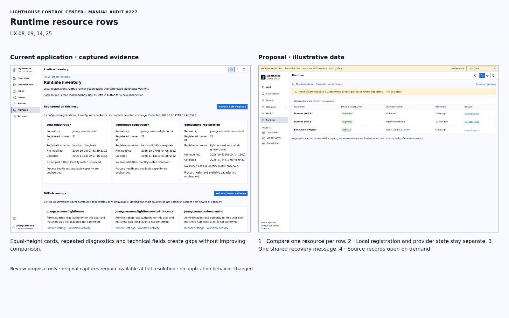
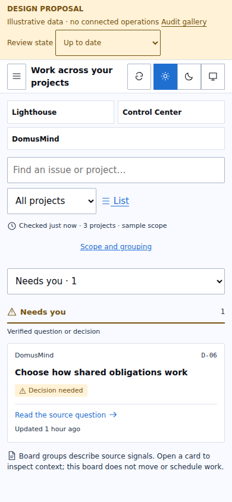
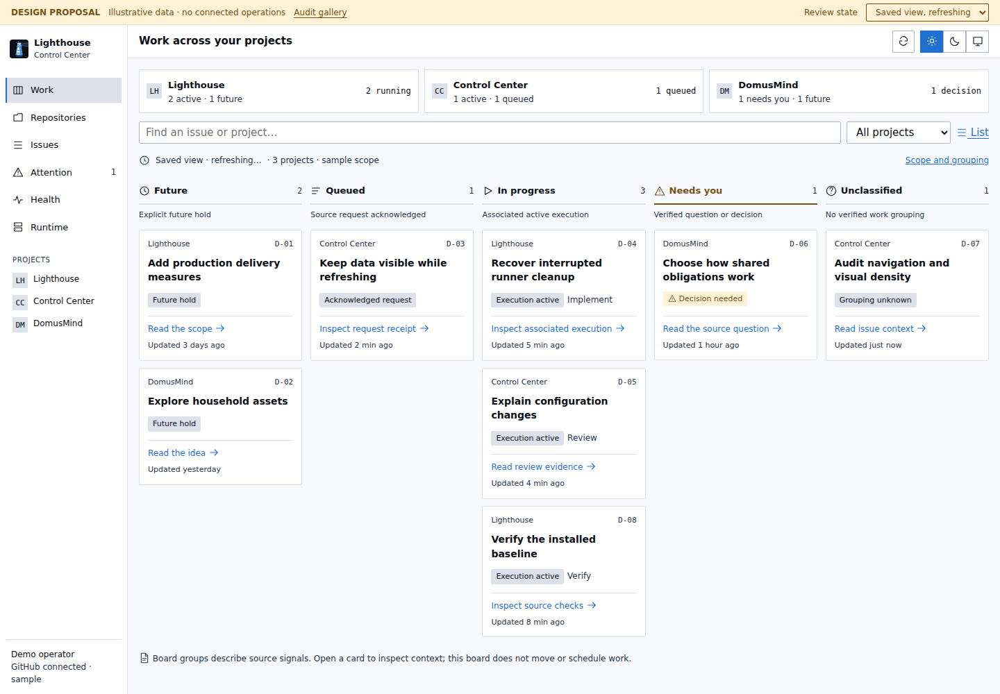

# Before/after review sheets

Actual application captures and synthetic proposals are labelled separately. Source screenshots are preserved, including any original-language issue content. These sheets compare composition, not the truth of the sample data.

## Work entry

**Observed:** Open/closed grouping leaves the work situation unclear. Project access is separated from the board.

**Proposed:** 1 · All projects are visible. 2 · Each column answers a work question. 3 · A verified human wait has a clear reading action. 4 · Source scope is available once.

Findings: UX-01, 05, 06, 10, 21, 26. [Full current capture](10-current-board-desktop-dark.png) · [full proposal](v2-work-desktop-dark.png).

## Health investigation

**Observed:** Coverage and unknown assessments dominate the first screen. The operator must locate the useful evidence.

**Proposed:** 1 · One concrete concern leads the page. 2 · Projects compare in compact rows. 3 · Source gaps differ from failing checks. 4 · Check detail opens its exact sample provenance.

Findings: UX-17, 22, 23, 27. [Full current capture](09-health-desktop-light.png) · [full proposal](v2-health-desktop-light.png).

## Issue context and draft

**Observed:** The initial reader foregrounds controls and composer before readable issue context. Returning loses an unsent draft.

**Proposed:** 1 · Context opens first. 2 · The shared dispatch limitation appears once. 3 · Draft and preview stay together. 4 · Secondary events and identifiers are inspectable.

Findings: UX-04, 07, 08, 16, 24. [Full current capture](12-long-issue-desktop-dark.png) · [full proposal](v2-issue-desktop-dark.png).

## Runtime resource rows

**Observed:** Equal-height cards, repeated diagnostics and technical fields create gaps without improving comparison.

**Proposed:** 1 · Compare one resource per row. 2 · Local registration and provider state stay separate. 3 · One shared recovery message. 4 · Source records open on demand.

Findings: UX-08, 09, 14, 25. [Full current capture](08-runtime-desktop-light.png) · [full proposal](v2-runtime-desktop-light.png).

## Mobile: direct access to attention

The selected group starts with Needs you. Other groups and counts are reachable through the selector. Repositories and all six primary routes are reachable through the menu. Health uses labelled stacked rows rather than a wide desktop table.

[Mobile Health](v2-health-mobile-light.png) · [mobile reader](v2-issue-mobile-dark.png) · [mobile runtime](v2-runtime-mobile-light.png).

## Continuity states

[Failed refresh, retained rows](v2-state-failed.png) · [lost-authority presentation](v2-state-revoked.png). These are presentation simulations; [the state contract](DESIGN-SPEC.md) defines the real implementation evidence still required.
