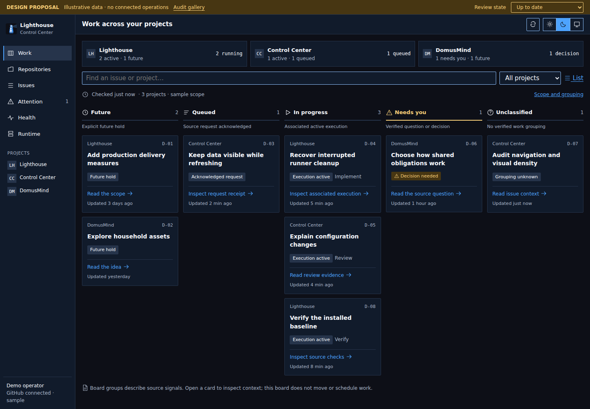

# Manual usability and UI/UX audit — Lighthouse Control Center

**Review issue:** [#227](https://github.com/juangcarmona/lighthouse-control-center/issues/227) · **Date:** 14 November 2026 · **Mode:** manual work with Juan; `future` and `human-working` retained.

The daily experience needs to start with work across projects, preserve what the operator was reading, and make exceptions easy to find. The current application already has useful compact issue rows, exact-number search, source links and some caching. Its main failures are the order of information, interrupted navigation and inconsistent presentation of uncertainty.

This expanded English edition includes a browser review of **Plain Concepts Platform and Project Health**, a broader interactive proposal, annotated comparisons, 28 findings, and a proposed manual epic with acceptance evidence. The original application captures remain unchanged: historical source content inside them may be Spanish. All authored guidance, issue text, labels in the proposals and review material are English.

## Start the review here

1. [Before/after review sheets](COMPARISONS.md): work, Health, issue reader and runtime.
2. [Plain Concepts reference review](REFERENCES.md): actual sites, captures, exercised interactions and transfer decisions.
3. [Interactive workspace proposal](workspace.html) / [single-file version](workspace-standalone.html): eight views, project/state filters, source detail, preserved draft and simulated refresh states. Serve this folder locally, or download the single-file version and open it directly. GitHub displays HTML source rather than running it.
4. [Interaction and acceptance specification](DESIGN-SPEC.md): information hierarchy, states, cache continuity, board semantics and proposed work slices.
5. [Screenshot gallery](index.html), [current-app observations](observations.json), [flow receipts](flows.json), [additional flows](secondary-flows.json), [new prototype checks](workspace-checks.json).

## Scope and evidence

The authenticated development application at `https://192.168.0.3:5443` was traversed with Playwright/Chromium using its documented development sign-in and already connected GitHub account. Nine base routes were captured at **1440×1000** and **390×844**, in light and dark appearance. Additional captures cover navigation, exact search, pagination, issue evidence, a lost draft and controlled read failures. Captures show the initial viewport unless explicitly marked otherwise.

The deployed process started on 13 November at 10:40:10 UTC from `preview-controls-7c0809d`. [source-receipt.json](source-receipt.json) records assembly hashes and twelve served assets. All twelve assets matched the observed `origin/main` revision **48c0b1b2ba32f830e6e3d7e000d712f6844c674c**. This is asset correspondence, not complete binary provenance. The pre-existing checkout at `ca01bfc4b31af118385a793dc4d5cb523423af74` contains unrelated changes and differs from several served resources. It was preserved.

The second pass inspected [Platform Foundations](https://platform.plainconcepts.dev/) and [Project Health](https://health.platform.plainconcepts.dev/) directly. Health identifies its deployment as generated example data. Its application patterns can be assessed; its numbers do not establish real engineering performance. Reference captures and interaction receipts are in [references/](references/). The original `.com` hosts failed DNS resolution in this browser; the public repository's demo link led to the working `.dev` Health site.

Lighthouse's [public website](https://lighthouse.jgcarmona.com/), [reference capture](00-lighthouse-reference-desktop.png), installed design guide and Control Center visual contract remain the visual authority. Plain's pink/blue palette, rounded cards, scoring policy and framework are not being adopted. Proposals reuse Lighthouse's served tokens and mark, 184px rail, 48px header and compact controls.

## What the comparative review changes

The first proposal addressed a board and issue reader but left much of the workspace unexplored. The expanded direction is:

- **Work first:** a cross-project board with a project strip, visible human waits and execution links. On mobile, a state selector opens attention first instead of stacking every future item above urgent work.
- **Projects remain visible:** a compact repository directory and project scope that survives drill-down and return. This adapts Platform's app-switching pattern without turning LCC into a separate app launcher.
- **Health becomes an investigation path:** short evidence exceptions, comparable rows, then checks and exact-source detail. It does not turn workflow success into a health score or deployment claim.
- **History is secondary:** source-backed chronology can explain a wait. A historical timeline is not a future schedule. The example distinguishes observed events from unavailable history.
- **Every status has a useful next step:** read the question, inspect a check, recover a connection or open source details. Technical explanations are available at the point of need.
- **Continuity is visible and testable:** saved, refreshing, failed-refresh, expired and lost-authority states have separate treatments. The state simulator demonstrates presentation only; it cannot prove authorization or backend caching.

## Current application: observed task outcomes

| Task | Outcome and practical consequence | Evidence |
| --- | --- | --- |
| Sign in and begin work | Callback opens Account. Authenticated root and sign-in callback disagree about the entry point. | [Account](01-account-desktop-light.png) |
| Find project work from Overview | First project starts at **879px desktop / 1187px mobile**, after workflow and status content. | [Overview](02-overview-desktop-dark.png), [measurements](observations.json) |
| Browse repository issues | Compact list starts at **128px desktop**. Preserve this density. | [Repository](05-project-desktop-light.png) |
| Find an older issue by number | `#48` + Enter resolves correctly in the selected repository. | [Exact search](11-exact-search-desktop-dark.png) |
| Read beyond the first page | Loading more expands the LCC collection from 9 to 32 issues; the control is hidden in coverage details. | [Additional flows](secondary-flows.json) |
| Change to board | Columns are Open/Closed/Unknown; they do not answer what is future, queued, active or awaiting a person. | [Current board](10-current-board-desktop-dark.png) |
| Understand an issue | Controls and editor precede collapsed context; long issue #48 has 11 comments. | [Reader](12-long-issue-desktop-dark.png) |
| Leave a draft and return | Draft is lost on navigation away and back. Nothing was submitted. | [draft-written / draft-return](flows.json) |
| Return with populated cache | At 350ms, no rows and a false confirmed-empty statement; cached rows appear after the account check. | [Before restoration](13-return-350ms-desktop-dark.png), [after](14-return-restored-desktop-dark.png) |
| Refresh during a read failure | Injected 503 preserves 33 previous rows, but repeats stale warnings throughout the collection. | [503](15-stale-after-503-desktop-dark.png) |
| Search for an absent title | Distinguishes no match from partial source coverage. Preserve that distinction. | [No match](16-no-match-desktop-dark.png) |
| Act on a human question | No labelled contexts in the received Inbox collection; resolution could not be exercised. | [Inbox](07-inbox-desktop-dark.png) |
| Inspect runtime | Local records are available; provider administration and adoption coverage are incomplete. Capacity/health cannot be concluded. | [Runtime](08-runtime-desktop-light.png) |
| Investigate Health | Project → contributing run works, with exact GitHub outcome/source link. Comparable assessment and deployment environments remain unavailable. | [Health](09-health-desktop-dark.png), [project](19-health-project-desktop-dark.png), [run](20-health-run-desktop-dark.png) |

## Findings register

**P1:** misleading state, lost work or blocked daily task. **P2:** orientation, interpretation or efficiency. **P3:** local consistency. UX-01–20 preserve the first audit's identifiers; UX-21–28 extend the review. New design opportunities are explicitly separated from reproduced defects.

| ID | Priority / evidence | Finding | Concrete proposal and acceptance |
| --- | --- | --- | --- |
| UX-01 | P1 · observed | Login opens Account. | Work entry after authentication; preserve authorized deep links and return paths. Test new session, returning session and recovery. |
| UX-02 | P1 · observed/source | Network account check precedes cache restoration. | Preserve the last permitted display within a verified scope while refreshing; measure first retained row and layout continuity. No cached write authority. |
| UX-03 | P1 · reproduced | Loading reports zero issues and a successfully collected empty scope. | Distinct initial/loading/restored/confirmed-empty/no-match/unavailable states; no confirmed-empty assertion before collection succeeds. |
| UX-04 | P1 · reproduced | Navigation loses an unsent comment. | Draft keyed by verified actor, repository and issue, with explicit retention/clearing policy; test return, reload and scope change. |
| UX-05 | P1 · observed + proposal | Open/closed board does not communicate work position. | Future, confirmed queue, active execution, human wait and unclassified groups; source association and conflict handling must be reviewed before implementation. |
| UX-06 | P2 · measured | Projects are below the first viewport on Overview. | Project strip and work above workflow details; first project/work row within 230px desktop under normal text size. |
| UX-07 | P1 · observed | Issue controls precede readable issue context. | Title, source state and context first; editor and result together; preserve long-description/history disclosure choices. |
| UX-08 | P2 · observed | Raw ISO/millisecond dates interrupt scanning. | Relative age plus concise calendar date, accessible exact timestamp and timezone; separate source-updated from last-checked. Invalid dates remain unknown. |
| UX-09 | P2 · reproduced | Shared stale warning repeated on every card. | One collection warning, short row marker only when necessary; retain original timestamps and explain individual exceptions. |
| UX-10 | P2 · observed | Dense rows lack useful work signals. | Text plus icon for verified execution/wait/hold; explain evidence on demand. Labels alone cannot establish queue or execution. |
| UX-11 | P2 · observed | Mobile destinations and breadcrumb are clipped. | Named menu, current route and reachable complete destination set; compact breadcrumb with full repository identity accessible. |
| UX-12 | P3 · observed | Health changes position between shells. | One route order, active marker and appearance control across all screens and deep links. |
| UX-13 | P2 · observed | Account repeats connection/identity prose and competing actions. | One identity/connection summary; relevant recovery first; permissions and destructive disconnection in explicit details. |
| UX-14 | P2 · observed | Runtime equal-height grids leave large gaps and duplicate explanations. | Resource rows, separate observed availability from unconfirmed provider state, expandable source details. |
| UX-15 | P2 · observed | Empty Inbox remains text-heavy. | One scoped empty statement and useful navigation; interpretation rules in help. Never claim the entire fleet has no waits from partial coverage. |
| UX-16 | P1 · API evidence | Refine/Propose denied; Continue policy unavailable. | Concrete recovery for each actual denial; qualify operations only with authorized source outcomes. No permission expansion in this audit. |
| UX-17 | P2 · observed | Health's unknown counters dominate useful evidence. | Compact comparison by project with explicit evidence gaps; drill into contributing checks/runs. No invented score. |
| UX-18 | P2 · observed | Repeated repository titles and mixed issue types obscure scanning. | Stable project column/chip, title prominence, explicit state/signal filters with preserved preferences. Do not silently hide automation failures. |
| UX-19 | P2 · source inspection | Cache helper exists but route adoption is inconsistent. | A per-route continuity contract for Work, repositories, issue, Health and runtime. Shared helper alone is not completion evidence. |
| UX-20 | P2 · exercised | Collection count looks complete; load more is buried. | Visible collected-count/partial-scope wording and collection-adjacent load more; preserve or explain pagination reset. |
| UX-21 | P2 · comparative opportunity | Projects have no persistent place in work orientation. | A compact cross-project directory and scope filter, inspired by Platform's app shell; keep ordinary repository identity. Return restores scope and filters. |
| UX-22 | P2 · comparative opportunity | Health gives little help choosing where to investigate first. | Rank explicit evidence problems by supported reason; show the reason and affected project. Unknown is a gap, not an inferred failure. |
| UX-23 | P2 · comparative opportunity | Detail explains current records but not the path from a concern to its evidence. | Fleet exception → project/check → exact run/revision. Two transitions in the proposal; preserve originating filter on return. |
| UX-24 | P2 · comparative opportunity | Activity and wait history are difficult to distinguish from scheduling. | Optional recorded-event chronology; gaps remain gaps. Do not add Gantt commitments or waiting-duration measures without timestamped source history. |
| UX-25 | P2 · comparative opportunity | Visual signals rely heavily on prose and isolated badges. | Consistent line icons, textual status, aligned columns, restrained status color and optional count bars with denominators. No score rings or decorative charts. |
| UX-26 | P2 · prototype review | First proposal stacked Future before attention on mobile. | Mobile group selector with attention initially visible, accessible counts and list alternative; desktop retains board. Test real thumb/keyboard flows before acceptance. |
| UX-27 | P2 · comparative opportunity | Metrics can look comparable despite different coverage or applicability. | Scope/time window/source type adjacent to values; unavailable, not applicable, detected and measured distinguishable. No aggregate across incompatible samples. |
| UX-28 | P2 · audit coverage gap | Happy-path screenshots under-specify recovery and return behavior. | Reviewable state matrix, task scripts and before/after measures; prove source outcomes separately from presentation. |

## Cache: what exists and what must improve

`read-projection-cache.js` uses sessionStorage, connection scope, a ten-minute lifetime and a two-MiB limit. Factory and Overview restore projections; permission verification precedes restoration. Runtime is an allowed view key but does not consume this helper. The issue reader and Account do not have equivalent restoration.

| Exploratory sample | Observation |
| --- | --- |
| Initial Issues request | DOM at 109ms; first 34 issues at **5407ms**. |
| Warm return | First restored row at **2195ms**. |
| Controlled delay | Added 1800ms to account and 2000ms to factory reads; zero rows at 350ms; first projection at **3756ms** (3838ms whole-flow measurement). |
| Controlled 503 refresh | 33 retained rows; no replacement with an empty collection. |

These are individual samples, not percentiles or an SLA. The delayed sample is not natural server latency. The implementation decision must reconcile continuous display with current verified identity/scope. A persistent shell or server-verified restoration are options to evaluate; this audit selects neither framework nor architecture. The detailed state matrix is in [DESIGN-SPEC.md](DESIGN-SPEC.md).

## Proposed manual epic

No child issues or stage-request labels are created by this report. Each slice needs before/after captures and its own acceptance evidence; new product semantics require the normal Product Change process.

| Order | Slice | Findings | Completion evidence |
| --- | --- | --- | --- |
| 1 | Honest loading and refresh states | 02,03,09,19,20,28 | Slow/failed/expired/changed-scope runs; retained rows, no false empty, visible pagination and safe scope handling. |
| 2 | Context-first reader and drafts | 04,07,16 | Same-issue return/reload, scope cleanup, preview focus and authorized source result or exact blocker. |
| 3 | Work entry and cross-project orientation | 01,05,06,10,18,21 | Reviewed grouping map, source receipts, preserved filters and correct login/deep-link entry. |
| 4 | Shared shell and mobile navigation | 11,12,26 | All routes reachable with keyboard/touch; desktop, 390px and 320px/200% captures in both themes. |
| 5 | Dates, rows and visual vocabulary | 08,09,18,25 | Consistent dates/timezones; icon/text parity, readable density and no clipped identity. |
| 6 | Health investigation | 17,22,23,24,27 | Concern → project → source drill-down with unknown/missing/stale/inapplicable cases; no unsupported aggregates. |
| 7 | Attention, runtime and account | 13,14,15,21 | Compact scoped states, distinct read/write availability, actionable recovery and no dead links. |
| 8 | Functional and usability acceptance | 16,28 + all | Full manual tasks with owner, source outcomes where authorized, baseline comparison and retained revision-bound evidence. |

## Verification and limits

- Existing app: 36 base captures; no page-level horizontal overflow at the tested sizes. Hidden navigation destinations remain a usability problem despite that result.
- Existing app: Axe desktop/light on nine routes found no violations. Issues at 320px with computed 32px root text had no page overflow. Limited keyboard/focus and emulated touch checks are retained. This is not exhaustive WCAG, screen-reader or physical-device qualification.
- Existing source availability: comment eligible; Refine/Propose `write-authority-denied`; Continue `policy-unavailable`; missing/unconfirmed reads include `contents`, `pull_requests`, `variables`. See [action-availability.json](action-availability.json).
- No application comment, workflow command, continuation, status change or prepare/confirm operation was sent. Real logout/revocation, new GitHub callback, large conversation pagination and uncertain-write recovery remain untested.
- Network delay and 503 were injected only into read requests in the audit browser. No service failure was caused. Private-certificate bypass was limited to the audit context and does not qualify production TLS.
- New workspace: 36 base screenshots across nine views, 18 desktop/theme Axe cases with zero violations, and no page overflow on all nine views at 320px/200% root text. Draft/filter/return/dialog/state interactions passed. The standalone file opens without external requests; menu focus, draft and appearance persistence passed. See [package-checks.json](package-checks.json).
- New workspace verification is recorded in [workspace-checks.json](workspace-checks.json). Its sample data, local draft and state selector prove prototype presentation and interaction only. They do not implement caching, authority checks, metrics or GitHub operations.
- Reference observations concern public pages and explicit demo fixtures. Neither Plain's production access nor its internal projects were inspected.
- No product implementation, canonical product/architecture edits, deployment, service restart, PR or merge. `npm run verify` was not run because the repository implementation was unchanged; isolated browser and artifact checks were used. See [REPRODUCE.md](REPRODUCE.md).
