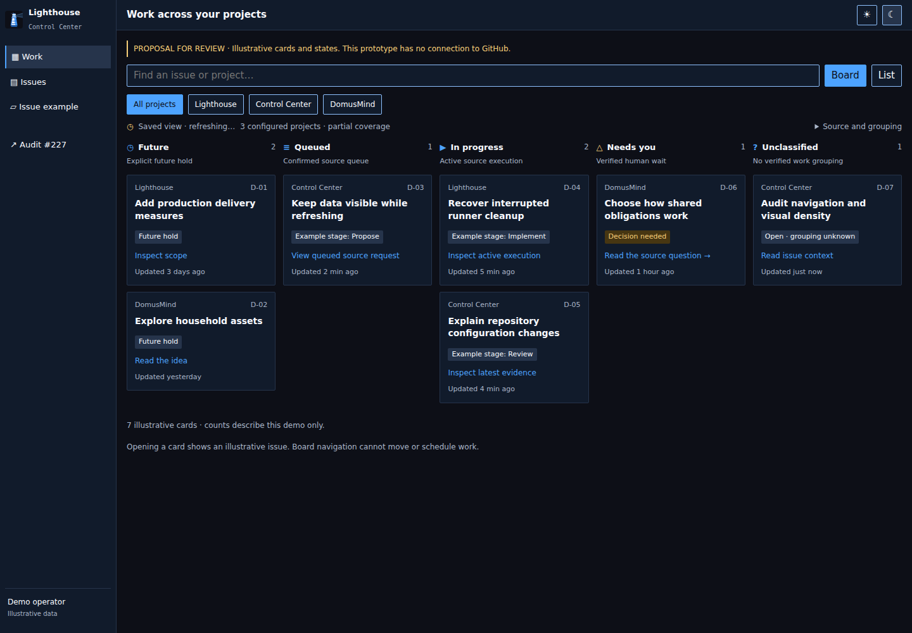
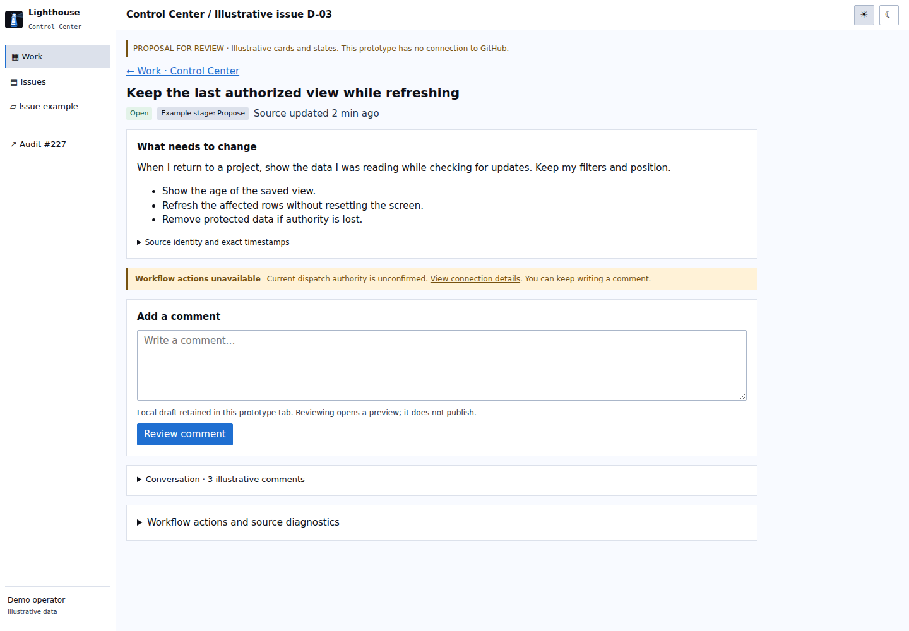

# Auditoría manual de usabilidad y UI/UX — Lighthouse Control Center

Fecha: 14 de noviembre de 2026. Encargo y revisión: [issue #227](https://github.com/juangcarmona/lighthouse-control-center/issues/227). Repositorio verificado: `juangcarmona/lighthouse-control-center`, ID **1425429121**.

La aplicación permite encontrar y leer trabajo real, pero la entrada, la continuidad y la jerarquía de información siguen dificultando el uso diario. Las prioridades son eliminar la falsa sensación de backlog vacío, conservar la lectura y los borradores, y presentar el trabajo de todos los proyectos antes que los detalles de cuenta o de ejecución.

Esta auditoría es trabajo manual conjunto con Juan. La issue mantiene `future` y `human-working`. No se han solicitado etapas Lighthouse, abierto PRs, aprobado cambios de producto, cambiado la aplicación ni reiniciado el servicio. El desglose de abajo es una propuesta para decidir juntos qué implementar.

## Evidencia y versión

Se recorrió el servicio autenticado de desarrollo en `https://192.168.0.3:5443`, con su cuenta GitHub ya conectada. El inicio de sesión usó la cuenta de desarrollo documentada. No se guardaron capturas del login ni se publicaron cookies, configuración privada, tokens o HARs.

El proceso se inició el 13 de noviembre a las 10:40:10 UTC desde un paquete llamado `preview-controls-7c0809d`. Ese nombre **no acredita por sí solo la revisión completa del binario**. Se registraron hashes de los dos ensamblados y de doce recursos servidos en [source-receipt.json](source-receipt.json). Los doce recursos coinciden con `origin/main` observado en **48c0b1b2ba32f830e6e3d7e000d712f6844c674c**. Varios también coinciden con el checkout, cuyo HEAD es `ca01bfc4b31af118385a793dc4d5cb523423af74`; Health y parte del shell difieren de ese checkout. Por tanto, actualizar el servicio no puede darse por solución de los fallos encontrados en esos recursos: están también en la fuente contrastada.

Playwright y Chromium realizaron el recorrido. Para el certificado privado de desarrollo se habilitó `ignoreHTTPSErrors` exclusivamente en los contextos de la auditoría. Esto no valida la confianza TLS de producción.

Las nueve vistas base se capturaron con datos recibidos, en escritorio **1440×1000** y móvil **390×844**, en claro y oscuro: 36 capturas. Se añadieron capturas de flujos, errores controlados, referencia y propuestas. Los tamaños de ventana son los indicados; las capturas muestran el primer viewport, no toda la página. Los textos y mediciones completos están en los JSON asociados.

Referencia visual consultada directamente con Chromium: [web de Lighthouse](https://lighthouse.jgcarmona.com/) y [captura de referencia](00-lighthouse-reference-desktop.png). Se contrastaron también `docs/design/DESIGN.md` y `docs/design/control-center.md`. El shell real cumple los 184 px de rail, cabecera de 48 px y cuerpo de 15 px; eso no resuelve la jerarquía del contenido.

## Recorridos y resultados

| Recorrido | Resultado observado | Evidencia |
| --- | --- | --- |
| Entrar e iniciar sesión | El callback abre `/workspace`, la cuenta, aunque la entrada operativa esté definida como intención. | [Cuenta](01-account-desktop-light.png) |
| Entender actividad de todos los proyectos | Se leen tres repositorios y workflows activos. El primer proyecto empieza a **879 px** en escritorio y **1187 px** en móvil en esta muestra. | [Overview](02-overview-desktop-dark.png), [mediciones](observations.json) |
| Encontrar un repositorio y sus issues | Funciona la selección y el acceso al lector compartido. La lista inicia a **128 px** en escritorio; esta densidad conviene conservarla. | [Proyecto](05-project-desktop-light.png) |
| Buscar por número fuera de las primeras páginas | `#48` + Enter devuelve la issue correcta de LCC, conservando el repositorio seleccionado. | [Búsqueda](11-exact-search-desktop-dark.png), [flows.json](flows.json) |
| Ampliar colección y leer evidencia | La siguiente página de LCC amplía de 9 a 32 issues. La lectura de evidencia de #53 termina; etapa y runs asociados siguen desconocidos en esa página, sin inventarlos. | [Lectura de evidencia](18-evidence-read-desktop-dark.png), [secondary-flows.json](secondary-flows.json) |
| Cambiar lista/tablero | Mantiene el ámbito, pero el tablero solo separa Open, Closed y Unknown. | [Tablero actual](10-current-board-desktop-dark.png) |
| Leer descripción, conversación y acciones | #48 carga descripción y 11 comentarios; la descripción queda plegada inicialmente y detrás del editor. Las acciones Lighthouse tienen bloqueos reales. | [Lector](06-issue-desktop-dark.png), [issue larga](12-long-issue-desktop-dark.png) |
| Escribir un borrador, salir y volver | El editor es editable; el borrador escrito se pierde al regresar. No se pulsó enviar ni se preparó una operación real. | [flows.json: draft-written / draft-return](flows.json) |
| Volver a Issues con caché poblada | Se restaura después de comprobar por red la cuenta. A los 350 ms hay cero filas y un mensaje que afirma una colección vacía. | [Antes de restaurar](13-return-350ms-desktop-dark.png), [después](14-return-restored-desktop-dark.png) |
| Refrescar con error de lectura | Un 503 simulado solo en lecturas conserva filas con advertencia stale. La degradación ya existe, aunque repite mucho texto. | [503 controlado](15-stale-after-503-desktop-dark.png) |
| Buscar un título inexistente | El mensaje diferencia ausencia de coincidencia y cobertura parcial. | [Sin coincidencia](16-no-match-desktop-dark.png) |
| Inbox | No hay contextos etiquetados en la colección recibida; no equivale a que toda la flota carezca de intervenciones. El flujo de resolver una pregunta no pudo ejercerse en este estado. | [Inbox](07-inbox-desktop-dark.png) |
| Runtime | Se leen registros locales; acceso GitHub de administración no confirmado y datos de adopción parciales. No se puede afirmar salud ni capacidad. | [Runtime](08-runtime-desktop-light.png) |
| Health | Presenta evidencia de Actions por proyecto y permite investigar; no hay evaluación comparable ni entornos verificados en esta muestra. | [Health](09-health-desktop-dark.png), [recorridos adicionales](secondary-flows.json) |
| Health → proyecto → run | Se abre Lighthouse y un run contribuente exacto, con resultado GitHub y enlace de origen. Esto no acredita entrega ni despliegue. | [Proyecto](19-health-project-desktop-dark.png), [run](20-health-run-desktop-dark.png) |

## Hallazgos y mejoras concretas

P1: interrumpe una tarea cotidiana, induce a error o pierde trabajo. P2: dificulta orientación o lectura. P3: ajuste local. Son prioridades de auditoría, no decisiones de entrega.

| ID | Prioridad | Problema y reproducción | Cambio propuesto y comprobación |
| --- | --- | --- | --- |
| UX-01 | P1 | Después de Sign in se abre Cuenta. La sesión válida puede llegar a Overview desde `/`, pero el callback conserva otro destino. | Llevar al trabajo tras autenticar; conservar enlaces profundos y usar Cuenta para conexión o recuperación cuando proceda. Probar login nuevo, retorno y deep link. |
| UX-02 | P1 | Caché poblada, navegación de vuelta: la pantalla vuelve a cero mientras espera `/api/connections/github`. | Mantener el shell y la última proyección autorizada cuando sea válido su ámbito; refrescar en segundo plano. Diseñar explícitamente cómo acreditar la sesión/ámbito antes de mostrar datos. No eliminar la comprobación de autoridad ni usar la caché para acciones. Medir vuelta a primera fila con red normal/lenta. |
| UX-03 | P1 | Durante esa espera, Issues dice `0 issues` y `The successfully collected scope contains no ordinary issues`. Todavía no se ha recogido el ámbito. | Separar no cargado, restaurando, vacío confirmado, filtro sin resultados y fuente no disponible. El mensaje de vacío confirmado jamás debe aparecer durante verificación/carga. |
| UX-04 | P1 | Escribir un borrador en #48 → Repositories → Atrás: el editor queda vacío. | Guardar borrador por actor verificado/repositorio/issue y restaurarlo en el mismo ámbito. Borrarlo ante cambio de actor o pérdida de autorización; acordar custodia y caducidad. Probar regreso, recarga y cambio de ámbito. |
| UX-05 | P1 | El board solo agrupa abierto/cerrado/desconocido. En el proyecto observado casi todo cae en una columna y quedan dos vacías. | Proponer una portada con futuro, cola confirmada, ejecución, intervención y sin clasificar. Conservar estado GitHub y etapa como dimensiones separadas. Revisar reglas de agrupación con Juan antes de implementarlas. |
| UX-06 | P2 | En Overview hay contadores, un panel sin esperas y todos los workflows antes de los proyectos. Los proyectos empiezan muy abajo. | Tener selector de proyectos y acceso al trabajo al comienzo. Limitar el detalle de workflows a un resumen desplegable o zona secundaria, con enlace a su fuente exacta. |
| UX-07 | P1 | La issue abre con acciones deshabilitadas y editor grande; descripción y conversación están plegadas por defecto. | Priorizar título, estado y contexto legible. Plegar descripciones muy largas con una apertura clara, preservar la elección y mantener comentario/resultado juntos. Mostrar el editor bajo el contexto o al pedir comentar. |
| UX-08 | P2 | Cuenta, Runtime y workflows muestran ISO con milisegundos en contenido principal. La lista ya usa edades relativas: hay inconsistencia. | Mostrar `hace 2 min`, `ayer, 18:40` o fecha local compacta; exacto y zona en detalle accesible. Distinguir actualizado en origen de última comprobación. Fechas inválidas siguen desconocidas. |
| UX-09 | P2 | En refresco fallido cada issue repite dos líneas de `Stale collection; current activity and labels are unknown`. El tablero se llena de la misma advertencia. | Una advertencia de colección y una marca breve por fila; detalle particular solo si cambia por registro. Conservar los tiempos originales y la incertidumbre. |
| UX-10 | P2 | La lista densa solo enseña Open/Closed y edad; futuro, trabajo activo y reserva humana no se distinguen sin abrir detalles. | Añadir indicios breves y con texto de las señales realmente recogidas. No traducir una etiqueta a una etapa, ni a cola o ejecución confirmadas. Enlace al detalle que explica la señal. |
| UX-11 | P2 | En 390 px la navegación horizontal solo muestra algunos destinos y corta el breadcrumb del proyecto. No hay desbordamiento de página, pero las opciones quedan fuera de vista. | Un menú móvil con nombre, destino actual y acceso evidente a todas las secciones; breadcrumb abreviado con identidad completa accesible. Probar teclado, tacto y regreso. |
| UX-12 | P3 | Health aparece después de Issues en el shell general y antes de Inbox en Health. | Un orden y nombres compartidos en todas las rutas; probar cuál permanece seleccionado al entrar por enlace profundo. |
| UX-13 | P2 | Cuenta repite identidad verificada, conexión separada, conexión verificada y listas extensas de permisos; muestra Connect y Disconnect con peso parecido estando conectado. | Tarjeta compacta de cuenta/conexión con acción pertinente; permisos, caducidad y revocación en detalles claros. Separar visualmente desconexión y cierre de sesión. |
| UX-14 | P2 | Runtime usa tres tarjetas de alturas iguales con campos largos, avisos repetidos y grandes huecos. Registros, runners y adopción forman bloques alejados. | Filas por recurso/proyecto, columnas compactas de disponibilidad y detalle al expandir. Mantener separadas las fuentes y sus permisos. Aviso compartido para límites comunes. |
| UX-15 | P2 | Inbox vacío sigue mostrando eyebrow, título, explicación, reglas de orden, ayuda, contexto y advertencia larga. | Estado vacío de una frase, con alcance/cobertura al lado y accesos a proyectos/actualizar. Mover reglas de interpretación a ayuda desplegable; no afirmar que no hay esperas fuera de lo observado. |
| UX-16 | P1 | Refine/Propose denegados por `write-authority-denied`; Continue no disponible por `policy-unavailable`. El usuario no puede completar esos flujos ahora. | Mantener el bloqueo y ofrecer una recuperación concreta con el diagnóstico ya disponible. Cerrar la calificación funcional solo con un resultado de origen, en trabajo expresamente autorizado. No ampliar permisos como efecto de esta auditoría. |
| UX-17 | P2 | Health consume espacio con contadores, investigación, tabs y tabla; muchas celdas principales son Unavailable/Unknown. | Priorizar problemas verificables y una fila compacta por proyecto; detalle de cobertura y fuentes al expandir. Mantener desconocidos sin fabricar puntuaciones o entornos. |
| UX-18 | P2 | Issues combina cerradas, ordinarias y fallos automáticos; repite el owner/repositorio en negrita en cada título. Cuesta localizar trabajo de producto. | Identidad de proyecto breve en columna/chip y título con peso principal. Filtros explícitos de estado y señales; recordar preferencia del usuario. No ocultar fallos automáticamente sin decisión. |
| UX-19 | P2 | La utilidad de caché admite factory, operations y runtime, pero Runtime no la consume; el lector y Cuenta tampoco tienen restauración equivalente. | Definir continuidad por vista, no solo una utilidad compartida. Verificar entrada, regreso y fallo en cada ruta, con las garantías de ámbito y revocación. Un TTL no sustituye una política de autoridad. |
| UX-20 | P2 | La colección es parcial; cargar más requiere abrir cobertura y encontrar un botón por proyecto. Un usuario puede interpretar el contador como total. | `N issues recogidas · cobertura parcial` y carga adicional junto a la colección, conservando el detalle por fuente. Al refrescar, explicar si se reinicia la paginación. |

La referencia de cada hallazgo está en los recorridos, capturas y JSON de este directorio. UX-04 es una pérdida reproducida en esta sesión; UX-19 combina inspección de fuente y capturas de carga, no una afirmación de que todas las rutas fallen de la misma forma.

## Qué ocurre con la caché

Existe `read-projection-cache.js`, con `sessionStorage`, ámbito de conexión, caducidad de diez minutos y límite de dos MiB. Factory guarda colecciones e historial; Overview tiene restauración equivalente para observaciones. La comprobación de permisos ocurre **antes de leer/restaurar** esa proyección. Esto explica parte de la espera observada; no hay evidencia de que falte por completo el mecanismo.

Mediciones exploratorias de una sesión, sin significado de percentil ni SLA:

| Caso | Resultado |
| --- | --- |
| Primera carga de Issues | DOM a 109 ms; primeras 34 issues a **5407 ms**. |
| Colección calentada, otra navegación | Primera fila restaurada a **2195 ms**; esa instantánea provenía de la búsqueda exacta anterior. |
| Regreso con demora controlada | Se añadieron **1800 ms** a la consulta de cuenta y **2000 ms** a lecturas factory. A los 350 ms: cero filas. Primera proyección a **3756 ms** desde navegación, **3838 ms** medidos en el recorrido completo. No es una medición de latencia natural del servicio. |
| 503 controlado durante refresh | Permanecen 33 filas antiguas, marcadas stale; no se sustituyen por un backlog vacío. El conjunto ya había cambiado respecto a la muestra inicial de 34. |

El arreglo necesita dos contratos: conservar presentación durante navegación y verificar autorización antes de exponer una proyección protegida. Opciones a evaluar: shell persistente con transición entre vistas y comprobación vigente de ámbito; o restauración admitida desde el servidor con estado de sesión/ámbito verificado. No se selecciona framework ni arquitectura en esta auditoría. Acciones, reservas, preguntas y permisos siempre requieren lectura vigente; un contador cacheado no habilita botones.

## Propuestas visuales para revisar

[Prototipo HTML/CSS](proposal.html), reutilizando los tokens servidos de Lighthouse y su marca. Es una simulación con siete tarjetas ficticias D-01…D-07. No son datos actuales, evidencia de ejecución ni estados asignados a issues reales. Sus únicas interacciones son filtro/búsqueda, lista/tablero, navegación de ejemplo, apariencia, borrador local y preview sin envío.

### A. Portada de trabajo de todos los proyectos

El proyecto y la búsqueda permanecen a mano. Las columnas permiten entender la situación del trabajo; etapa, espera y resultado no se confunden. El aviso de refresco aparece una vez. Las tarjetas ofrecen contexto y el siguiente lugar útil al que ir.

La regla ilustrativa de precedencia es: pregunta humana verificada → ejecución activa → cola confirmada → hold futuro → sin clasificar. Es una decisión pendiente: una issue puede tener varias señales a la vez. `ready` no demuestra cola; `future` no es etapa; un workflow activo solo representa una issue si existe asociación verificada. Las filas sin asociación quedan explícitamente sin clasificar. No hay drag-and-drop ni nuevas transiciones.

En móvil el prototipo apila grupos. Antes de implementar conviene probar un selector compacto que permita abrir primero En curso/Necesita tu atención sin recorrer Futuro. El prototipo muestra composición, no una navegación móvil aprobada.

[Claro](proposal-board-desktop-light.png) · [Móvil oscuro](proposal-board-mobile-dark.png) · [Móvil claro](proposal-board-mobile-light.png).

### B. Lector con contexto, diagnóstico breve y borrador

Contexto primero, metadatos secundarios plegables, motivo común de bloqueo en una sola franja, editor y preview juntos. El ejemplo conserva su borrador en la pestaña; la implementación real requerirá clave y limpieza por ámbito autorizado. El prototipo no puede demostrar esa seguridad ni un envío GitHub.

[Oscuro](proposal-detail-desktop-dark.png) · [Móvil claro](proposal-detail-mobile-light.png) · [Móvil oscuro](proposal-detail-mobile-dark.png).

## Desglose propuesto de la pequeña épica

No se crean issues hijas ni se autoriza implementación todavía. Cada incremento deberá conservar evidencia antes/después y vincularse a este informe.

| Orden | Trabajo revisable | Hallazgos | Criterios de aceptación |
| --- | --- | --- | --- |
| 1 | Estados de carga y ausencia | UX-03, UX-09, UX-20 | Nunca presentar vacío confirmado durante carga. Conservar filas en fallo transitorio. Alcance parcial y paginación claros, sin repetir el mismo párrafo por fila. |
| 2 | Continuidad entre vistas | UX-02, UX-19 | Contrato explícito de identidad/ámbito. Datos restaurados mientras se refresca cuando esté permitido. Conservar filtros, disclosure y posición. Probar lentitud, 503, 401/403, sustitución de cuenta y caducidad, sin relajar autoridad. |
| 3 | Borradores y lector | UX-04, UX-07 | Contexto visible al abrir, borrador recuperado en mismo ámbito, resultado/confirmación junto al editor, conversación y descripción largas manejables. Probar pérdida/cambio de ámbito y política de almacenamiento. |
| 4 | Entrada y portada | UX-01, UX-05, UX-06 | Revisar agrupaciones y mobile con Juan; Product Change si cambian semánticas aceptadas. Login y retorno llevan al trabajo; todos los proyectos accesibles en primer viewport. Tarjetas con asociación de fuente y agrupación desconocida explícita. |
| 5 | Filas, fechas y señales | UX-08, UX-10, UX-18 | Fechas legibles y exactos accesibles. Título/proyecto/estado/siguiente paso claros. No inferir lifecycle ni autoridad; preferencias de filtro conservadas. |
| 6 | Navegación móvil y consistencia | UX-11, UX-12 | Todas las rutas localizables, mismo orden y selección, breadcrumb legible; tacto, teclado y 320/390 px con 200% de texto. |
| 7 | Cuenta, Inbox, Runtime y Health | UX-13, UX-14, UX-15, UX-17 | Resumen compacto por contexto, límites comunes una vez, datos técnicos expandibles, cero y desconocido diferenciados. Revisar cada pantalla en claro/oscuro. |
| 8 | Cierre funcional de operaciones | UX-16 | Recuperación concreta del fallo actual y prueba de origen de las operaciones expresamente autorizadas. Receipts y preguntas reales; una captura de un botón no completa el criterio. |

El contrato visual ya establece entrada operativa, detalles secundarios plegables y continuidad. Corregir desajustes no requiere inventar intención nueva. La semántica del nuevo tablero y la custodia de borradores requieren revisar el modelo y las decisiones correspondientes antes de elegir implementación.

## Verificación y límites

- Nueve vistas reales, cuatro combinaciones de viewport/apariencia: sin desbordamiento horizontal de página. Esto no significa que el nav horizontal haga visibles todos los destinos.
- Axe en las nueve vistas reales, escritorio y tema claro: **cero violaciones detectadas**. No se ejecutó Axe en todas las combinaciones ni se considera una auditoría WCAG exhaustiva.
- Issues a 320 px con raíz calculada de **32 px** (200%): sin desbordamiento de página. No se ha generalizado ese resultado a todas las rutas.
- Tacto emulado: navegación, refresco y apariencia tienen altura de 44 px; refresco y apariencia miden 44×44. No acredita un teléfono físico.
- Teclado: búsqueda exacta con Enter, escritura y comprobación focal limitada; no hay revisión exhaustiva con lector de pantalla.
- Prototipos: filtros, búsqueda, lista, navegación, recuperación de borrador de demo, preview, foco, 320 px/200% y capturas claro/oscuro; Axe en escritorio en ambos temas. Resultados en [proposal-checks.json](proposal-checks.json).
- [action-availability.json](action-availability.json): comentario elegible y almacenamiento disponible; Refine/Propose `write-authority-denied`; Continue `policy-unavailable`; scopes de lectura pendientes o no confirmados `contents`, `pull_requests`, `variables`. No se sustituyó la cuenta conectada por credenciales del operador.
- No se enviaron comentarios, comandos, continuaciones ni cambios de estado desde la aplicación. No se probó prepare/confirmar de operaciones reales, logout/revocación real, callback GitHub nuevo, conversación paginada grande ni recuperación de una operación incierta. Son límites funcionales explícitos, no resultados satisfactorios.
- El 503 y la demora de red se inyectaron en el navegador de la auditoría sobre endpoints de lectura. Ninguna caída del servicio ni denegación real fue provocada.
- No se ejecutó `npm run verify` del repositorio: no se cambió producto, runtime, pruebas ni documentación canónica. Se ejecutaron los recorridos y comprobaciones de auditoría descritos, en un directorio separado. El checkout preexistente conserva sus modificaciones.

## Archivos

[Observaciones por pantalla](observations.json) · [Flujos principales](flows.json) · [Flujos adicionales](secondary-flows.json) · [Versión y hashes](source-receipt.json) · [Acciones reales disponibles](action-availability.json) · [Checks del prototipo](proposal-checks.json).

La galería `index.html` permite comparar pantallas y abrir el prototipo al descargar este directorio. Los scripts de reproducción se incluyen sin estado de navegador ni credenciales; necesitan una sesión de desarrollo creada por el operador en un fichero privado externo. Los artefactos publicados son evidencia de esta auditoría y propuestas pendientes de revisión, no una nueva versión de la aplicación.
