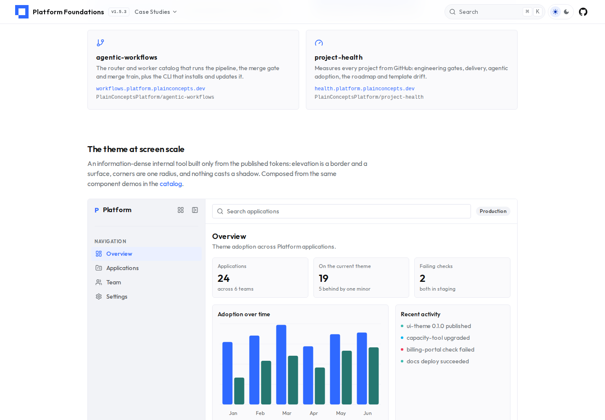
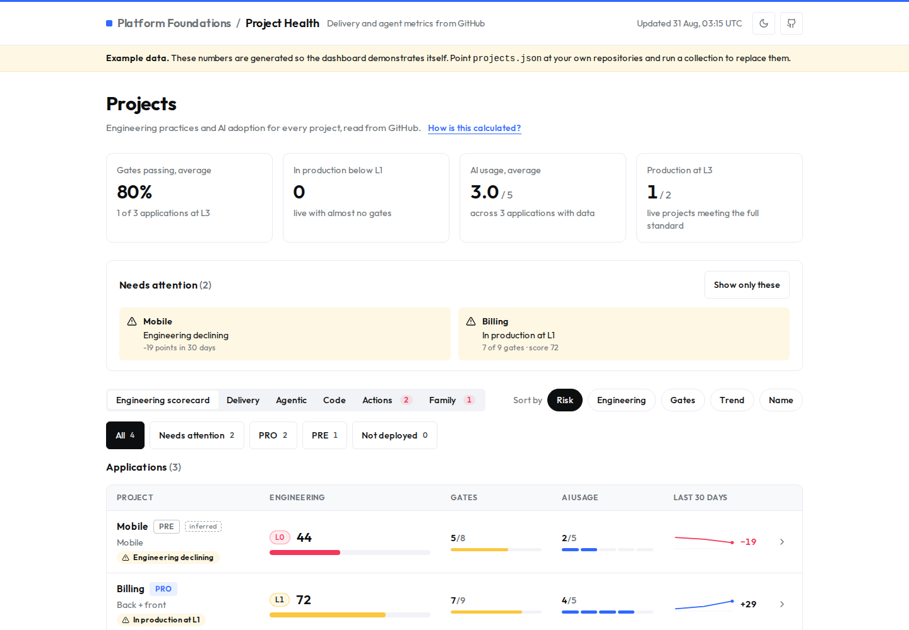
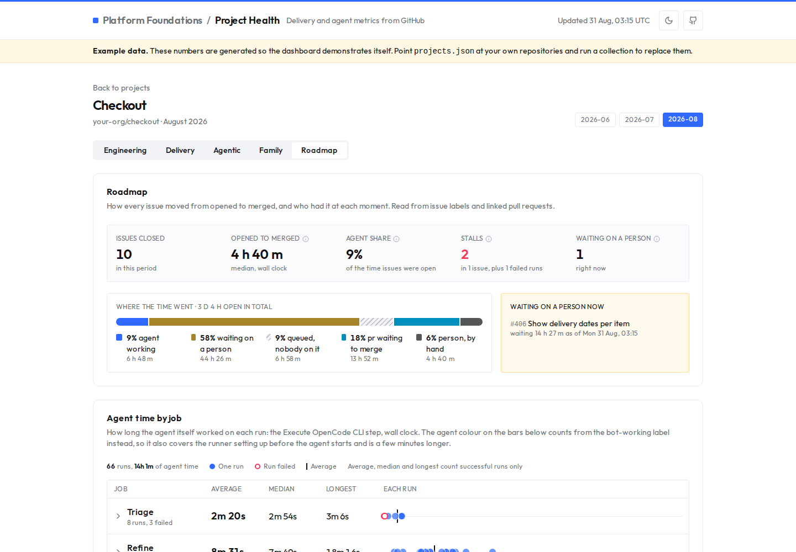

# Reference review: Platform Foundations, Project Health and Orbion

Reviewed on 14 November 2026. These references inform original LCC proposals. Lighthouse's visual contract and the accepted LCC product model retain authority.

## What was actually inspected

| Reference | Evidence level | Scope |
| --- | --- | --- |
| [Platform Foundations](https://platform.plainconcepts.dev/) | Operated public documentation and embedded interactive app example | Home, mobile home, process documentation, application shell example and App Hub control. The embedded example is a demonstration, not an operated company application. |
| [Project Health](https://health.platform.plainconcepts.dev/) | Operated public deployment with explicit example data | Overview, attention-only filter, Checkout project, Engineering, Delivery, Agentic and Roadmap tabs, light/dark appearance and 390px layouts. |
| Orbion | Private repository source review | Repository inspected at the owner's request. Its private source, internal details and potential screenshots are excluded from this public evidence package. No live Orbion interaction or performance result is claimed. |
| [Lighthouse](https://lighthouse.jgcarmona.com/) | Operated public site plus local design contract | Native visual authority: shell proportions, typography, restrained surfaces, controls and appearance. |

The working Health host was reached through the public project's [demo link](https://github.com/PlainConceptsPlatform/project-health). The `.com` Platform and presumed Health hosts failed browser DNS resolution; this does not establish a service outage. Browser receipts: [initial scan](references/scan.json), [first reference flows](references/flows.json), [tab and mobile flows](references/deep-flows.json). Source analysis of Project Health was limited to the local checkout at `75d57a8a5db91da6e0a5a86616d29943d5c4c77d`; a deployment-to-source match was not established.

## Platform: composition and shared navigation

The embedded screen demonstrates a recognizable rail, small line icons, search at a stable location, grouped data and a product/application switcher. The documentation shell keeps the same language across navigation and components. These details make orientation less dependent on paragraphs.

**Transfer to LCC:** keep project access persistent; use a single shared route order; put filter/search in one toolbar; use a clear title and aligned data. The proposed repository directory and project strip are original LCC compositions. Retain Lighthouse's mark, semantic palette, square edges and 15px typography.

**Do not transfer:** a documentation hero into an operational entry, a demo's application adoption numbers, or framework and component dependencies. Platform's App Hub belongs to its app ecosystem; LCC's project navigation represents repositories.

[Home desktop](references/platform-home-desktop.png) · [home mobile](references/platform-home-mobile.png) · [process documentation](references/platform-process-desktop.png) · [App Hub control after click](references/platform-app-hub.png).

## Health: choose a problem, compare projects, inspect evidence

The overview places named concerns above a compact comparison, supports an attention-only filter and offers different lenses over the same projects. Rows combine a project identity, status text, small count/score visuals and a trend. Project pages expose the underlying practices and their evidence sources. This is a useful path from fleet overview to a specific reason.

**Transfer to LCC:** identify a concrete evidence problem, show the affected project and reason, then let the operator inspect the check and source record. Use count bars only alongside actual counts and denominators. Keep missing producers, stale observations and not-applicable measures distinct. The new Health proposal deliberately includes an evidence gap and an unavailable history case.

**Do not transfer:** L0–L3 levels, score weights, organizational thresholds, deployment classifications or AI adoption ratios. Those encode Plain's policy and data contracts. LCC's observed Actions evidence does not currently support the same assessment. The demo's numbers are generated; no real performance conclusion follows.

[Attention filter](references/health-attention-filter.png) · [project checks](references/health-project-engineering.png) · [Delivery](references/health-project-delivery.png) · [Agentic](references/health-project-agentic.png) · [dark overview](references/health-overview-dark.png).

## Health: history explains waits, but does not schedule work

The Roadmap tab presents a recorded issue timeline, distinct categories of time and selectable issue detail. In the exercised demo it exposes label/PR events and related source context. The documentation describes it as a historical view, collected periodically. See the public [Roadmap documentation](https://platform.plainconcepts.dev/docs/health/roadmap).

**Transfer to LCC:** offer a recorded-event chronology when events exist; join it to an issue's exact source identity. Explain whether a timestamp is an event, observation or inferred duration. A concise chronology is enough for the first proposal. A full chart needs retained, source-associated history and a useful operator question.

**Do not transfer:** historical bars as future commitments, Plain-specific label classifications, or wall-clock time as agent execution time. A current label cannot reconstruct the duration of a wait. The proposed Future group represents an explicit hold, not a promised delivery date.

[Dark roadmap](references/health-roadmap-dark.png) · [mobile roadmap](references/health-roadmap-mobile.png).

## Reference weaknesses to avoid

The browser reported page-level horizontal overflow at **390×844** on Health's overview and Roadmap in this session; the corresponding 1440px captures had none. See `overflow` in [deep-flows.json](references/deep-flows.json). The project Engineering table is dense and explanation-heavy. The overview's first application row also follows several summary blocks. These are reasons to adapt its useful patterns rather than reproduce each screen.

The LCC proposal therefore uses stacked labelled rows on mobile, one selected work group at a time, accessible project filters and concise evidence detail. Existing screenshot evidence establishes the reference limitation; it is not a full accessibility audit of Plain's products.

## Transfer decisions

| Pattern | LCC decision | Proposal / verification |
| --- | --- | --- |
| Stable shared shell | Adopt under existing Lighthouse visual contract | Every proposal view uses one rail/header/order; mobile menu exposes all six destinations. |
| Cross-project switcher | Adapt to repository scope | Project strip + directory; URL/filter preservation. |
| Exception-first comparison | Adapt with explicit evidence reasons | Attention → Health concern → check → source dialog. |
| Visual score and levels | Defer | No aggregate score or maturity level in the proposal. |
| Historical Gantt | Defer | Source-event chronology only; missing history labelled. |
| Dense desktop tables | Adapt for narrow screens | Mobile labelled rows; no page overflow in the new proposal checks. |
| Common source explanation | Adopt | Collection-level freshness and scope disclosure; row-specific exceptions only. |
| Plain's implementation stack | No adoption decision | Prototype uses isolated native HTML/CSS/JS and Lighthouse tokens. |

The private Orbion review was used to challenge navigation continuity, shared data presentation, action prominence and reading context. This package contains original LCC design decisions, not a port or publication of private implementation material.
