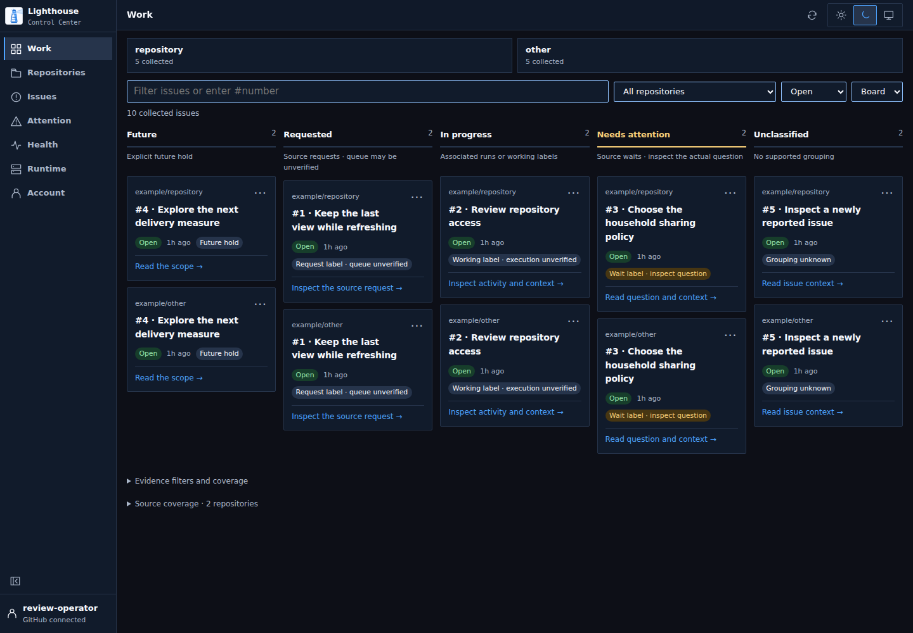
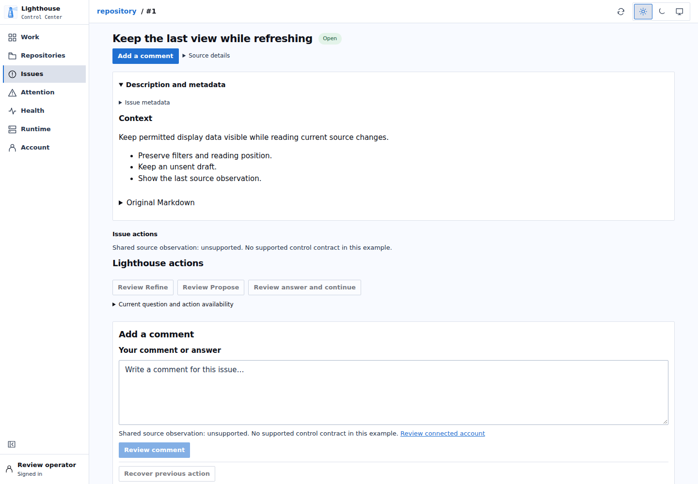
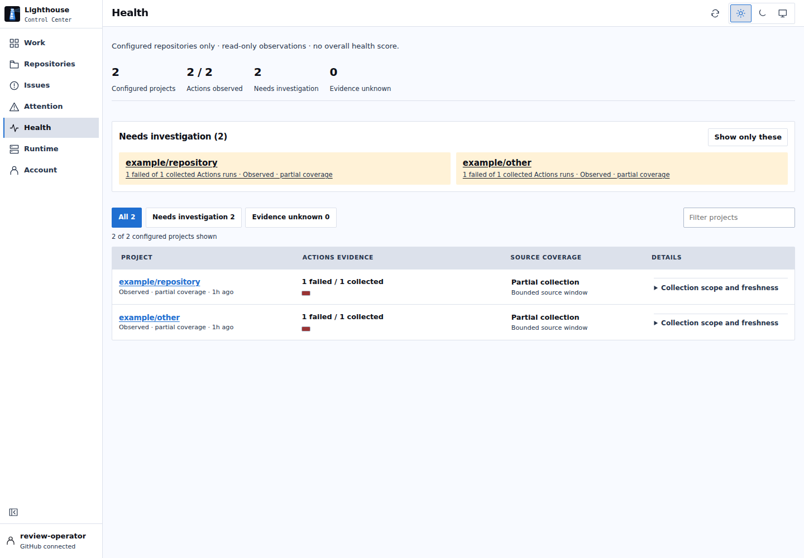
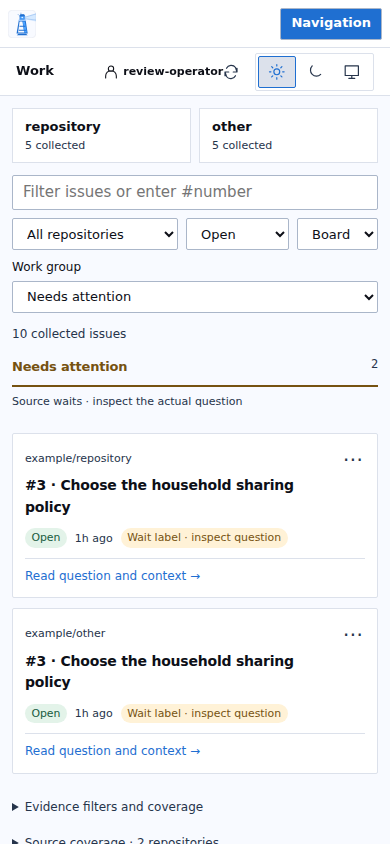

# Issue 227: implemented workspace usability

Manual work for [#227](https://github.com/juangcarmona/lighthouse-control-center/issues/227), built in the dedicated `feat/227-workspace-usability` worktree from `2d489ae`. This evidence describes the implementation in the containing Git revision. The original dirty checkout and the shared preview were preserved.

## Changes to review

Work is the default authenticated destination. Desktop shows projects and a cross-project board; narrow layouts open Needs attention and offer a group selector or list. Future, Requested, In progress, Needs attention and Unclassified describe observed signals. A request label does not prove queue admission, and a working label does not prove execution. Associated source evidence remains inspectable; moving cards never changes lifecycle.

Permitted saved rows appear before the account refresh completes. Protected documents supply a recent display-only scope from the existing owner session and repository-read receipts. The browser restores only matching data, marks it saved and checks current authority independently. Denial, connection replacement and owner expiry clear dependent display and drafts. APIs and actions continue to check their own authority.

Issue context opens before the action/editor area. Disclosure choices survive refresh; return links restore collection scope. Unsent text survives navigation and reload within a bounded, actor/connection/issue-scoped draft store. Confirmed publication clears only matching text. Existing review, confirmation and uncertain-result recovery remain separate from drafts.

Dates use concise English calendar/relative forms. Shared navigation has one route order and a keyboard-accessible narrow menu. Health uses compact source-evidence rows, Runtime separates resources and source details, and Account moves secondary permissions/session controls into disclosures.

## Audit and reference decisions

The [original English audit and 28 findings](https://github.com/juangcarmona/lighthouse-control-center/blob/d32148bf51afd66a42bbad431fd1d84088623339/docs/audits/2026-11-14-ui-ux-227/README.md), [before/proposal comparisons](https://github.com/juangcarmona/lighthouse-control-center/blob/d32148bf51afd66a42bbad431fd1d84088623339/docs/audits/2026-11-14-ui-ux-227/COMPARISONS.md) and [reference review](https://github.com/juangcarmona/lighthouse-control-center/blob/d32148bf51afd66a42bbad431fd1d84088623339/docs/audits/2026-11-14-ui-ux-227/REFERENCES.md) remain immutable evidence from the earlier audit phase.

Plain Concepts Platform informed persistent project orientation. Plain Concepts Health informed concern-to-project-to-source investigation and compact comparisons; its demo scores, policy, palette and framework were not adopted. The private Orbion repository was inspected read-only for data continuity, URL filters and contextual interaction patterns. No private source, captures or implementation details are reproduced here. Lighthouse's design tokens and visual contract remain authoritative.

| Findings | Implementation and limits |
| --- | --- |
| UX-01–04, 06–09, 11–15, 18–21, 26 | Entry/deep-link recovery, immediate scoped restoration, honest loading, drafts, context-first reading, dates, shared navigation, compact secondary views and visible paging. |
| UX-05, 10, 25 | Signal-based board and compact status presentation. Labels remain explicitly unverified where source execution/admission is absent. |
| UX-17, 22, 23, 27 | Compact Health rows and existing source drill-down; coverage stays explicit. New metrics and scores are outside this implementation. |
| UX-16 | Existing source denial/recovery stays visible. The audit observed Refine/Propose `write-authority-denied` and Continue `policy-unavailable`; this change does not expand permissions. Live operation qualification remains open. |
| UX-24 | Existing issue history remains available. New recorded-event chronology or scheduling is deferred pending timestamped source evidence and product review. |
| UX-28 | Browser state/return checks and implementation captures added. Owner-led live acceptance and physical-phone checks remain open. |

## Captures and reproducibility

The visual matrix uses explicit synthetic repositories, issues and source responses. Images are initial viewports of the implemented pages, rather than the audit prototype. They prove presentation under those fixtures; they do not prove connected-provider availability or source-operation success.

Run `TMPDIR=<private writable directory> npm run verify` and `TMPDIR=<private writable directory> npm run test:visual` after `npm ci`. The private temporary directory is needed because this host's ambient temporary-directory ancestor is group writable and the existing protected-storage checks correctly reject it. No storage check was weakened.

The matrix in [usability.spec.mjs](../../../../tests/browser/usability.spec.mjs) covers nine views at 1440×1000 and 390×844, light/dark, Axe and page overflow. Every view is also checked at 320px with a computed 32px root font (200%). Account has its own four visual cases. Native tests exercise real owner/deep-link and display-receipt boundaries. Browser tests exercise retained rows while a request is held, denial cleanup, initial-loading honesty, draft return/reload/scope change and existing source-action review/recovery fixtures.

Validation passed: `npm run verify` (120 Node tests, 276 native workspace tests, 38 native runtime tests and 136 browser tests) and `npm run test:visual` (22 cases). The Release build produced no warnings or errors; specification/product/security/architecture checks passed. [verification.json](verification.json) records source/image hashes, covered states, environment and limits.

The successful run set `DOTNET_PROCESSOR_COUNT=4` after an initial internal CLR crash during the unbounded solution test. Both final commands used the private temporary directory described above. No checks were disabled.

## Acceptance still required

No deployment, shared service restart or merge is part of this PR. Screens were checked in Chromium with emulated narrow viewports; physical-phone, screen-reader and owner-led connected-source acceptance remain separate. No live comment, workflow command or continuation was submitted for these captures. Issue #227 remains manual and open for those qualifications and the deferred opportunities above.

## Screenshot review

| Implemented view | Desktop light | Desktop dark | Narrow light | Narrow dark |
| --- | --- | --- | --- | --- |
| Work | [1440px light](images/implemented-work-1440-light.png) | [1440px dark](images/implemented-work-1440-dark.png) | [390px light](images/implemented-work-390-light.png) | [390px dark](images/implemented-work-390-dark.png) |
| Repositories | [1440px light](images/implemented-repositories-1440-light.png) | [1440px dark](images/implemented-repositories-1440-dark.png) | [390px light](images/implemented-repositories-390-light.png) | [390px dark](images/implemented-repositories-390-dark.png) |
| Issues | [1440px light](images/implemented-issues-1440-light.png) | [1440px dark](images/implemented-issues-1440-dark.png) | [390px light](images/implemented-issues-390-light.png) | [390px dark](images/implemented-issues-390-dark.png) |
| Repository scope | [1440px light](images/implemented-project-1440-light.png) | [1440px dark](images/implemented-project-1440-dark.png) | [390px light](images/implemented-project-390-light.png) | [390px dark](images/implemented-project-390-dark.png) |
| Issue context | [1440px light](images/implemented-issue-1440-light.png) | [1440px dark](images/implemented-issue-1440-dark.png) | [390px light](images/implemented-issue-390-light.png) | [390px dark](images/implemented-issue-390-dark.png) |
| Attention | [1440px light](images/implemented-attention-1440-light.png) | [1440px dark](images/implemented-attention-1440-dark.png) | [390px light](images/implemented-attention-390-light.png) | [390px dark](images/implemented-attention-390-dark.png) |
| Health | [1440px light](images/implemented-health-1440-light.png) | [1440px dark](images/implemented-health-1440-dark.png) | [390px light](images/implemented-health-390-light.png) | [390px dark](images/implemented-health-390-dark.png) |
| Project Health | [1440px light](images/implemented-health-project-1440-light.png) | [1440px dark](images/implemented-health-project-1440-dark.png) | [390px light](images/implemented-health-project-390-light.png) | [390px dark](images/implemented-health-project-390-dark.png) |
| Runtime | [1440px light](images/implemented-runtime-1440-light.png) | [1440px dark](images/implemented-runtime-1440-dark.png) | [390px light](images/implemented-runtime-390-light.png) | [390px dark](images/implemented-runtime-390-dark.png) |
| Account recovery | [1280px light](images/account-light-1280.png) | [1280px dark](images/account-dark-1280.png) | [390px light](images/account-light-390.png) | [390px dark](images/account-dark-390.png) |

